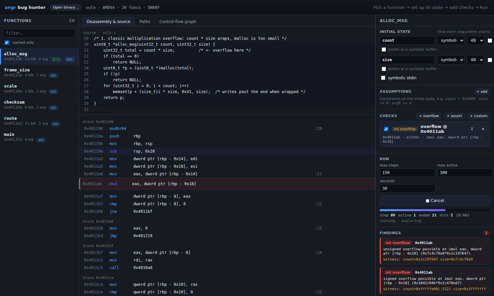

# angr bug hunter

A visual, click-driven front end for [angr](https://angr.io) built for bug
hunting. Instead of writing a throwaway Python script for every function you
want to symbolically execute, you manage everything visually:

- **per-function assumptions** about the initial state — which arguments are
  symbolic, how wide they are, what constraints they must satisfy, whether an
  argument points at a symbolic buffer, whether stdin is symbolic;
- **the paths angr explored**, drawn as a tree and overlaid on the
  control-flow graph, annotated with source lines;
- **checks** you attach to a function and reuse — the built-in one is an
  **integer-overflow** check you add by clicking the arithmetic instruction (or
  the source line) you care about, plus assertions, reachability checks, and
  your own Python predicates.

Everything you set up for a binary is saved next to it (`<binary>.angrgui.json`)
so a project persists across restarts.



## Install & run

```bash
pip install -r requirements.txt          # angr, fastapi, uvicorn
python run.py                            # serve http://127.0.0.1:8000
# or load a binary immediately and open a tab:
python run.py --binary samples/vuln --open
```

Then: **Open binary** → pick a function → set up its initial state on the right
→ add checks → **Run**. Findings show up with a concrete witness (the exact
input values that trigger them).

There is a small deliberately buggy sample included:

```bash
make -C samples          # builds samples/vuln + its example project (needs gcc)
```

The tool analyzes x86-64 Linux ELF binaries. On macOS the system `gcc` is
clang producing Mach-O, so the Makefile picks up an x86-64 Linux
cross-compiler instead (`brew install filosottile/musl-cross/musl-cross`).
angr needs Python ≥ 3.10; use e.g. `python3.12 -m venv .venv`.

## The checks

| Check | What it answers | How you add it |
|-------|-----------------|----------------|
| **integer overflow** | can this `add`/`sub`/`mul` wrap (unsigned) or leave the signed range? | click **+ overflow** on an arithmetic instruction, or add one for the whole function |
| **assert** | can this invariant be made *false* on some path? | **+ assert**, write an expression like `total < 0x10000` |
| **reach** | does any path reach this address? | **reach** on any instruction (works for library calls like `abort` too) |
| **avoid** | which paths reach an address you wanted to avoid? | **avoid** on any instruction |
| **custom** | anything else | **+ custom**, write `def check(state, api): ...` |

Every finding carries a **witness**: concrete argument (and stdin) values,
solved so that they actually trigger the condition on that path.

### How overflow detection works (and why it's reliable)

The overflow check does **not** read CPU registers inside an instruction
breakpoint — mid-block register and memory values are not committed under
angr's block-at-a-time VEX engine, so they read stale. Instead it watches the
**result of each VEX arithmetic expression**: for an N-bit `add`/`sub`/`mul`
the resulting claripy AST carries its two operands, and the check asks the
solver whether, under the current path constraints, the widened result can
differ from the N-bit result. If yes, that's a reachable overflow, and the same
query yields the witness. Assertions, reach/avoid and custom checks are
evaluated at **block boundaries**, where register and memory reads *are*
committed, so they're reliable too.

## Reading the Paths tab

angr runs the function with your symbolic inputs. At every branch whose
direction depends on those inputs it takes **both** sides, so the run splits.
The Paths tab draws that as a tree:

- each row is one stretch of execution between two splits;
- the blue **condition** is what the inputs must satisfy to take that side
  (`cmd == 2`, `x s> 1000`, `stdin[0] <= 4`, in the expression-language
  syntax below), next to the source line that made the decision;
- a path's full condition is every condition from the top down to it;
- rows that end a path (`#1`, `#2`, …) say how it ended (returned *value*,
  called `abort()`, hit the loop bound, jumped somewhere the input controls, …)
  and give example inputs that drive execution down it;
- a **finding** badge sits on the stretch where a check fired, and a red rail
  leads to it.

Click a row for the whole path (conditions, source lines executed, example
input, findings). The path is also highlighted in the code view and the
control-flow graph.

## The angr script tab

Shows the selected function's setup (initial state, assumptions, checks,
limits) as a standalone angr script that does what the GUI does. Use it to see
what each setting means in angr terms, or copy/download it and extend it.
Symbolic arguments become `claripy.BVS` passed to `call_state`, assumptions
become `add_constraints` (expressions are compiled to claripy code), overflow
checks become an `inspect` breakpoint on VEX expressions, and
assert/reach/avoid/custom checks run on each new state after every step.

## The expression language

Used for assumptions and assertions (and `api.eval(...)` in custom checks):

```
count < 0x1000              unsigned compare
arg0 s>= 0 && arg0 s< 100   signed compare (prefix s), boolean &&, ||, !
total == count * size       + - * / % & | ^ << >>
u32(rax) != 0               width casts: u8/u16/u32/u64, s8..s64
[rbp - 8]:4 >= len          memory load: [addr]:size (bytes)
ret                         the return-value register
```

Names resolve to: the arguments you named, DWARF locals (when the binary has
debug info), CPU registers, and `ret`.

## Custom checks

```python
def check(state, api):
    # runs at each block boundary (or at one address if you pinned it)
    cond = api.eval("total > 0x7fffffff")
    if api.sat(cond):
        return {"message": "total can exceed INT_MAX",
                "witness": api.witness(cond)}
    return None
```

`api` gives you `eval("expr")`, `sat(cond)`, `witness(cond)`, `reg("rax")`,
`mem(addr, size)`. Custom checks run arbitrary Python in the server process —
only load projects you trust.

## Driving it with an agent (MCP)

The tool is itself an **MCP server**, so an AI agent can operate it while you
watch in the GUI. Point any MCP-capable client (Claude Code, Claude Desktop, …)
at `http://<host>:<port>/mcp`. The agent and the GUI share one backend session,
so every agent action shows up live: the GUI **follows** the agent to the
function it configures, shows the assumptions/checks it sets, and streams its
run into the Paths tab. A live **Activity** feed (top bar) logs everything, from
you or the agent. It runs arbitrary Python (custom checks), so keep it on a
trusted/local network, like the IDA connection.

Tools: `get_status`, `list_functions`, `get_function`, `disassemble`,
`decompile`, `configure`, `add_assumption`, `add_check`, `run`, `get_run`.
A typical agent loop: `list_functions` → `configure` (symbolic args + limits) →
`add_assumption` / `add_check` → `run` → `get_run` (status, findings with
concrete witnesses, and the path tree). The GUI subscribes to the same events
over Server-Sent Events at `/api/events`.

## Connecting IDA (names + decompilation)

For a stripped binary, angr shows `sub_<addr>` and machine code. You can pull
real function names and Hex-Rays **decompilation** from IDA over an IDA MCP
server: click **IDA** in the top bar, enter the server URL, Connect. IDA's names
overlay the function list and a **Decompilation** tab shows the pseudocode for
the selected function. The binary open in IDA must be the same one loaded here
(addresses must line up).

Two servers are supported and auto-detected:

| Server | IDA | How |
|--------|-----|-----|
| **mrexodia/ida-pro-mcp** (community) | 8.3+ | `pip install`/`uvx` its package, `ida-pro-mcp --install`, open the binary in IDA, press **Ctrl+Alt+M** to start it, and run its bridge on the network. Reads your open IDA GUI. |
| **Hex-Rays ida-mcp** (official) | 9.4+ | `uvx ida-mcp http --host 0.0.0.0 --port 8737` (set `IDADIR`). Code-mode server; opens the database itself. |

Running IDA in a VM (e.g. Parallels)? Bind the server to `0.0.0.0`, open the
port through the guest firewall, and connect to `http://<vm-ip>:<port>/mcp`.
The connection is made from the tool's backend, so there is no browser/CORS
issue. Needs no IDA to use the rest of the tool — it is entirely optional.

## Layout

```
run.py                 launcher
angrgui/
  engine.py            load binary, CFG, DWARF vars, disassembly, source mapping
  runner.py            build initial state from assumptions, explore, collect path tree
  pretty.py            render branch conditions / return values readably
  codegen.py           turn a setup into a standalone angr script
  idamcp.py            optional IDA MCP client (names + decompilation)
  checks.py            the check framework (overflow / assert / reach / avoid / custom)
  exprlang.py          the expression mini-language
  workspace.py         per-binary saved assumptions + checks
  server.py            FastAPI backend
  static/              the single-page UI (index.html, app.js, vendored dagre)
samples/vuln.c         deliberately buggy demo program
tests/                 pytest suite that finds the planted bugs
```

## Notes & limits

- **Stripped binaries with no source** work: functions show up as `sub_<addr>`,
  arguments are recovered from the calling convention and named `arg0`, `arg1`,
  … (rename them in the setup panel), and branch conditions in the Paths tab are
  phrased over those names. The "named only" filter turns itself off when a
  binary has essentially no symbols.
- Symbolic execution has inherent hard cases you will meet on real code: a
  compiler's **jump table** (an optimized `switch`) is an indirect jump on a
  symbolic index and does not fan out into one branch per case; and a condition
  that depends on a **hash or other heavy computation** becomes a large
  expression and can make the solver slow. A single solver query can run past
  the time budget (which is checked between steps), so Cancel may take a moment.


- The instruction-level overflow check targets x86/x86-64 (it reads capstone
  mnemonics to skip address arithmetic); the VEX-level detection itself is
  architecture-independent, so function-wide scans still work elsewhere, just
  with more noise.
- On a function that calls others, angr explores *into* the callees, which can
  burn the step budget before your function branches. Turn on **skip calls**
  (Run panel, or `limits.skip_calls`) to make each call return an unconstrained
  value so exploration stays in the function you care about — its branches then
  show up in the path tree.
- Symbolic execution explores loops; a **loop bound** (default 12) keeps a loop
  with a symbolic trip count from unrolling forever. Raise `max steps`,
  `seconds` and `loop bound` for deeper searches.
- angr prints a one-time warning that `unicorn` is unavailable — harmless, it
  just falls back to the standard engine.

## Tests

```bash
pytest -q          # builds samples/vuln, then finds each planted bug
```
